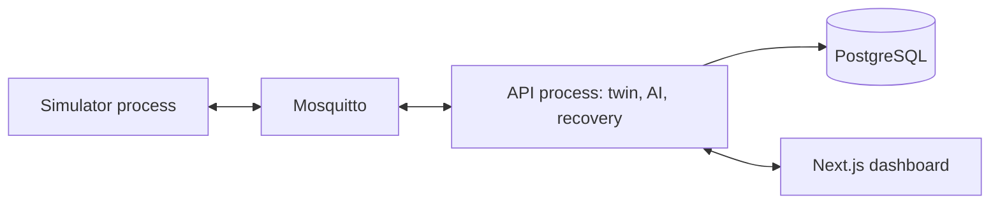

# Industrial Twin-X

An intelligent, autonomous and cyber-resilient Industrial IoT digital twin built entirely in software. It is a B.Tech third-year Internet of Things mini project (2025–2026).

**Everything here is simulated.** There are no physical sensors, controllers or machines, and no result in this repository is a real-world hardware measurement.

## What it does

- Simulates a factory with 3 zones, 5 gateways, 10 machines, 100 devices and 300 sensors, using seeded physical models. A headless run is byte-identical for a given seed.
- Streams versioned telemetry through Eclipse Mosquitto into a digital twin with reported and desired state, and persists it to PostgreSQL.
- Detects anomalies, classifies faults, estimates degradation and produces a maintenance risk score.
- Protects machines locally on the gateway even when central services are unreachable.
- Detects manipulated sensors by cross-checking redundant sensors.
- Runs incidents through an audited recovery state machine, where high-impact or low-confidence actions need a named human.
- Provides a 12-page command center with a 3D factory view.
- Runs repeatable experiments and generates figures from the measured data.



## Quick start (Windows)

Needs Docker Desktop with WSL2, [uv](https://docs.astral.sh/uv/), Node.js and pnpm.

```powershell
Copy-Item .env.example .env        # then set POSTGRES_PASSWORD
. .\scripts\env.ps1
uv python install 3.13
uv sync
pnpm install

# Models are not committed. Without them the system uses rule-based diagnosis.
.\.venv\Scripts\python.exe -m research.datasets.generate --runs-per-class 20 --seed 1000
.\.venv\Scripts\python.exe -m research.experiments.train

.\scripts\dev.ps1                  # starts everything
```

Open the dashboard at http://127.0.0.1:3000. API docs are at http://127.0.0.1:8000/docs. Stop with `.\scripts\dev.ps1 -Stop` after closing the app windows.

The [deployment guide](docs/architecture/deployment-guide.md) has a demonstration script and troubleshooting.

## Key results (simulation only)

Details and caveats are in the [experiment results](research/reports/experiments/README.md) and [AI design](docs/architecture/ai-design.md).

| Question | Result |
| --- | --- |
| Motor overheating with central disconnected | Failed in 5 of 5 runs without edge protection, 0 of 5 with it |
| Single-sensor tampering | Detected in 5 of 5 runs for both attacks, in 47 to 58 s, with no machine action caused |
| Message delivery during a 900 s link loss | 1.000, using store and forward |
| Best anomaly detector | The statistical baseline (F1 0.969). The Isolation Forest scored 0.677 and missed slow overheating |

Protection reduced output within the one-hour test window, and the simulator does not cost machine damage. The results do not show an economic benefit.

## Status and limitations

Working: the simulator, MQTT pipeline, twin, persistence, AI models, all scenarios, recovery engine, dashboard and experiment runner.

Not done or not validated:

- OPC UA is not implemented.
- Broker and API have no authentication or TLS, so they must stay on localhost. See the [security design](docs/architecture/security-design.md).
- Physics models are not calibrated against real machines, and model scores are likely optimistic for that reason.
- The risk score is not a calibrated probability, and no remaining useful life is predicted.
- The full stack has not been benchmarked at 500 devices; only the engine has.
- The [project report](docs/project-report/Industrial_Twin_X_Final_Report.pdf) is complete; only signatures are added on the printed copy. See the [report audit](docs/project-report/REPORT_AUDIT.md).

## Team

B.Tech Computer Science and Engineering third-year IoT mini project (2025–2026), Sri Chandrasekharendra Saraswathi Viswa Mahavidyalaya (SCSVMV), Kancheepuram.

| Name | Roll number |
| --- | --- |
| Bollavram Sandeep Kumar | 11249A040 |
| D. Gopala Krishna Rayudu | 11249A078 |
| K. Harish | 11249A150 |

Project guide: Ms. Hema Poorani J.

## Repository layout

| Path | Contents |
| --- | --- |
| `simulation/` | Virtual factory: engine, devices, sensors, actuators, network, scenarios |
| `modules/` | Twin, telemetry, AI, edge, security, recovery |
| `apps/api`, `apps/web` | FastAPI service and Next.js dashboard |
| `infrastructure/` | Mosquitto configuration and database migrations |
| `research/` | Dataset generation, training, experiments, reports |
| `tests/` | Unit, simulation, evaluation and integration tests |
| `docs/` | Architecture, design decisions, environment audit, project report |

See [CONTRIBUTING.md](CONTRIBUTING.md) for how to run the tests.
