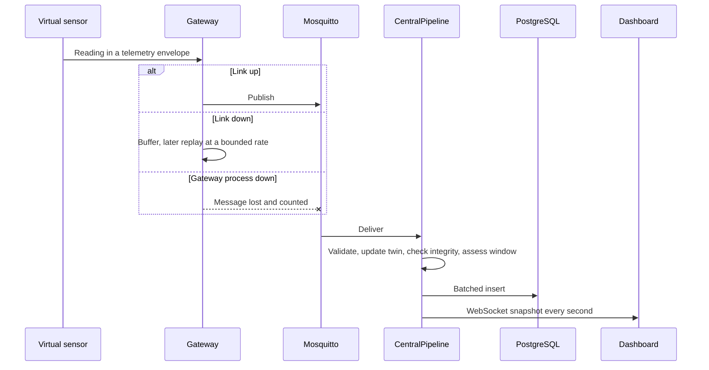

# Data Flow



## Topics

| Topic | Direction | QoS |
| --- | --- | --- |
| `industrial-twin-x/factory/{factory}/zone/{zone}/device/{device}/telemetry` | Simulator to API | 0 |
| `industrial-twin-x/factory/{factory}/device/{device}/status` | Simulator to API | 1 |
| `industrial-twin-x/factory/{factory}/device/{device}/commands` | API to simulator | 1 |
| `industrial-twin-x/factory/{factory}/alerts` | Simulator to API | 1 |
| `industrial-twin-x/factory/{factory}/network` | Simulator to API | 0 |
| `industrial-twin-x/factory/{factory}/control` | API to simulator | 1 |

## Telemetry schema, version 1.0

```json
{
  "schema_version": "1.0",
  "factory_id": "plant-01",
  "zone_id": "A",
  "machine_id": "MTR-A01",
  "gateway_id": "GW-A1",
  "device_id": "MTR-A01-controller",
  "timestamp": 1767225900.0,
  "sim_time": 300.0,
  "sequence": 60,
  "scenario_id": "normal",
  "status": "running",
  "readings": { "rpm": 1478.2, "current_a": 21.4, "power_kw": 12.8 },
  "replayed": false
}
```

Unknown fields, NaN, infinity, empty readings and negative sequences are rejected and counted.

## Ordering rules

- A repeated sequence number is a duplicate and is ignored.
- An older sequence number, such as replayed backlog, is persisted but does not overwrite current twin state.
- A jump in sequence numbers adds to the device's gap count.
- Replayed telemetry skips live analytics, because its time has passed.
- A backwards jump in simulation time means a new run, so analytics state is reset.
