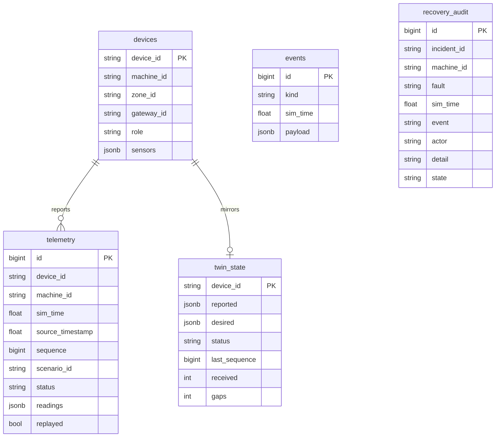

# Database Design

PostgreSQL 17 runs in Docker Compose. The schema is defined in `apps/api/twinx_api/db.py` and managed by Alembic in `infrastructure/database/alembic`.

## Write path

Rows enter a bounded queue of 20,000 and are flushed each second in batches of up to 500. When the queue is full, or a batch fails, rows are dropped and counted, so a slow or absent database never blocks the digital twin. The count is visible on the Overview page.

Twin state is upserted every 5 seconds. The audit table is insert-only in application code; this is a convention, not a database-enforced permission.

## Limitations

- Telemetry has no retention policy. At the default 10x speed it grows by roughly 200 rows per second, so clear the volume between long sessions if disk matters.
- Incidents live in memory and are not restored after an API restart. Their history stays in `recovery_audit`.
