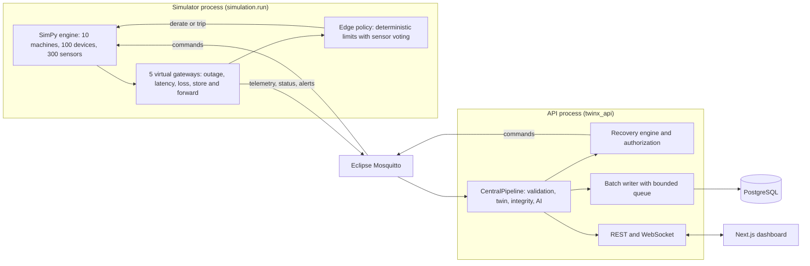

# System Architecture

Industrial Twin-X is a modular monolith with two independent processes. Everything it models is simulated; there is no physical hardware.

## Modules

| Path | Responsibility |
| --- | --- |
| `simulation/factory` | Static layout, scalable to 500 devices |
| `simulation/devices` | Lumped physical models of motors, conveyors, robots, pumps, tank, power units, environment |
| `simulation/sensors` | Calibration error, noise, quantisation, contained tampering |
| `simulation/actuators` | Hard limits the simulated device enforces itself |
| `simulation/network` | Gateway uplink model |
| `simulation/scenarios` | Scripted faults |
| `simulation/engine` | Shared SimPy engine, independent of MQTT |
| `modules/telemetry` | Topics, versioned schemas, central pipeline |
| `modules/digital_twin` | Registry-backed reported and desired state |
| `modules/anomaly_detection` | Window features and detectors |
| `modules/fault_diagnosis` | Random forest and rule baseline |
| `modules/predictive_maintenance` | Degradation regression and risk score |
| `modules/edge_computing` | Gateway-local protection |
| `modules/cybersecurity` | Sensor integrity checks and quarantine |
| `modules/recovery_engine` | Incident state machine, audit trail, command authorization |
| `apps/api` | FastAPI, MQTT bridge, persistence |
| `apps/web` | Command center |
| `research` | Dataset generation, training, experiments, metrics |

Rationale is in [the design decisions](../design-decisions/README.md).

## Implementation status

Implemented: everything in the diagram, all listed scenarios and all 12 dashboard pages.

Not implemented: OPC UA, user accounts on the API, broker authentication and TLS, XGBoost and PyTorch (not needed so far).
